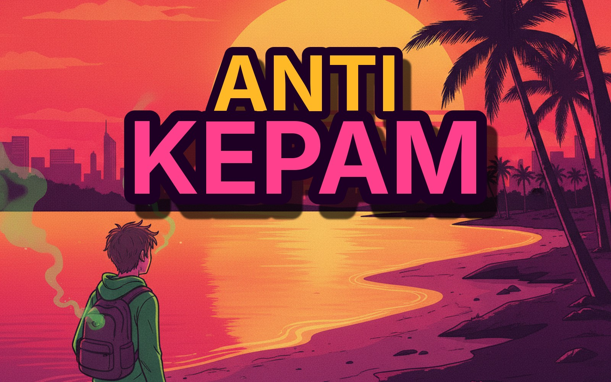

# Anti-Kepam



A Godot 4 game jam game in a GTA-style sunset look (Vice City colours, cel-shaded, thick outlines), written in a mix of English and Malay.

*Kepam* is Malaysian slang for "smelly".

## Story

A kepam boy gets dumped on WhatsApp by his girlfriend:

> "You terlalu kepam untuk I, kita break. Bye."

He has to wash at four places around town, then jump into the Golden Lake, before she marries someone else.

## How to play

**Goal:** wash at all four stations in order, then dive into the Golden Lake before the girlfriend's timer runs out.

| Key / input | Action |
|---|---|
| WASD / arrow keys | Walk around the hub |
| SPACE | Wash / action |
| Mouse (drag, click) | Scrub, aim, answer |
| E | Answer a knock at the door / hide in the mall |
| B | Buy soap or tissue near the hygiene shop |
| ESC | Settings: audio, options (language, touch buttons, accessibility), key rebinding |

On phones and tablets an on-screen joystick and buttons appear (they can be turned on or off in the ESC settings). Gamepads work too.

### Stations

1. **R&R** - time your taps to wash without falling asleep.
2. **Gas Station** - scrub graffiti and bacteria off a public toilet with the mouse (soap = bigger eraser) and answer the door when people knock.
3. **LRT** - swipe your card through the reader, answer 6 hygiene questions, then watch him enter the stall (door opens, closes) and shower.
4. **Shopping Mall** - run through a neon maze to the toilet while a lipas (cockroach) hunts you. Hide in spots to throw it off, spray it dead at the door, then the shower runs by itself.
5. **Golden Lake** - he jumps in off the bank and the game goes straight to the ending. A brighter lake needs better scores at the stations.

Kuman (germs) are the currency. Spend them on soap and tissue at the hub shop.

### Bottom bar

- **Kepam Negeri** - a green gas-cloud bar that fills as the smell spreads across the state.
- **Mood** - the boy's face goes from hopeful to worried, sad, crying and finally numb as the girlfriend's timer runs out.

### You lose if

- The kepam spread reaches 100% (the state goes viral on Berita Kepam 26).
- The girlfriend's timer runs out and she marries someone else.
- The lipas at the mall catches the boy.
- The lake is too dim (final score below 60%).

Each loss has its own cinematic ending. Winning has one too, plus a secret ending for a perfect run with no soap bought.

The game is playable in Malay or English (MS / EN on the menu or in settings). Pick Santai, Biasa or Kepam Gila on the hub for difficulty.

## Run it

Needs [Godot 4.x](https://godotengine.org/) (developed on 4.7).

```sh
git clone https://github.com/idrisharis12/Anti-Kepam.git
cd Anti-Kepam
godot --path .
```

Or open `project.godot` in the Godot editor and press F5. The first run imports the assets.

Rendering is `gl_compatibility` at 960x540 with `canvas_items` stretch.

## Project layout

```
assets/       backgrounds, sprite sheet, portraits
audio/music/  looping music tracks
audio/sfx/    sound effects (placeholders)
scenes/       small .tscn stubs that attach a script
scripts/      all game code; the UI is built in code
submission/   GamePix icon (512x512) and cover (1600x1000)
```

Autoloads: `GameState` (progress, score, timers) and `Sfx` (music, sound effects, volume).

## Status

Game jam build for the Xsolla Game Jam (14 Nov). Submitted to GamePix for review (game ID K07902, namespace `anti-kepam`). Sound effects are generated placeholders.

Not done: pause menu, animated how-to, results screen with retry, voice sounds. The GamePix SDK is only called for `loading`. Several paths are untested in play (mall hiding and timers, credits and secret ending, gamepad and key rebinding, touch buttons on a real device).

### Web build (GamePix)

```sh
godot --headless --path . --export-release Web build/web/index.html
cd build/web && zip -qr ../anti-kepam-web.zip .
```

The Web preset has threads off, so it needs no special server headers. Zip the contents of `build/web/` with `index.html` at the zip root.

### Web audio

Browsers block sound until the player interacts with the page. On the first click, key press or tap, `Sfx` (`scripts/audio.gd`) resumes the browser audio context, unmutes Master and restarts the current music track. The "mute when tab loses focus" option is skipped on the web, because inside an iframe the focus-in event can fail to arrive and leave the game muted. If GamePix still plays no sound, the next step is a "tap to start" screen.

## Credits

Game design, code and direction: Blakie, built with Claude Code.
Art: generated with an image model, then edited. Music: tracks supplied by the author.
